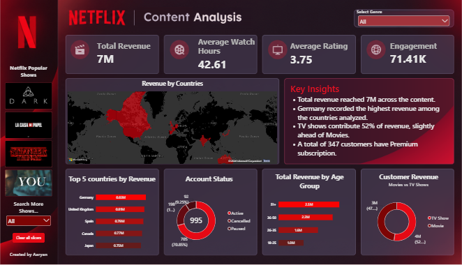

# 🎬 Netflix Content Analysis | End-to-End Data Analytics Project

An end-to-end data analytics project on Netflix customer data: raw Excel data cleaned with **Python**, stored and analysed with **SQL (MySQL)**, and visualised in an interactive **Power BI** dashboard.



---

## 📌 Project Overview

The raw dataset had duplicates, missing values, inconsistent text and invalid records. This project takes it from **raw Excel → clean dataset → SQL analysis → interactive dashboard** to answer questions like:

- Which countries generate the most revenue?
- Do TV Shows or Movies bring in more revenue?
- How many customers are active, paused or cancelled?
- Which age groups and subscription plans matter most?

---

## 🛠️ Tools & Technologies

| Stage | Tool | Used For |
|---|---|---|
| Data Cleaning | **Python** (Pandas, NumPy) | Cleaning, validation, feature engineering |
| Data Storage | **MySQL** (SQLAlchemy, PyMySQL) | Loading the cleaned data into a database |
| Analysis | **SQL** | Business queries on customers, revenue, genres, devices |
| Visualisation | **Power BI** (Power Query, DAX) | Interactive dashboard |
| Raw Data | **Excel** | Source dataset |

---

## 📂 Repository Structure

```
Netflix-Content-Analysis/
├── Dashboard/
│   ├── Netflix.pbix                   # Power BI dashboard
│   └── dashboard.png                  # Dashboard preview
├── Dataset/
│   └── Netflix_Unclean_Project.xlsx   # Raw dataset (1,013 rows x 20 columns)
├── Python/
│   ├── NetflixProject.ipynb           # Data cleaning notebook
│   └── NetflixProject.html            # HTML export of the notebook
├── SQL/
│   └── Netflix_Sql_Queries.sql        # SQL analysis queries
└── README.md
```

---

## 🧹 Data Cleaning (Python)

Raw data: **1,013 rows x 20 columns** → cleaned data: **995 customers**.

1. **Explored** the data with `head()`, `info()`, `describe()` and `shape`.
2. **Duplicates:** found and removed 5 duplicate records.
3. **Dirty values:** replaced `N/A`, `NULL` and blank strings with proper nulls.
4. **Text standardisation:** stripped extra spaces and fixed casing (e.g. country, title, plan names).
5. **Data types:** converted numeric columns with `pd.to_numeric`.
6. **Invalid records:** removed ages outside 18-100, negative watch hours and zero/negative fees.
7. **Missing values:** filled numeric columns (Age, Watch Hours, Monthly Fee) with the mean, and categorical columns (Genre, Device, Payment Method) with `Unknown`.
8. **Feature engineering:** created new columns:
   - `Customer_Revenue` = Monthly Fee x Monthly Sessions
   - `Engagement_Score` = Watch Hours + Monthly Sessions + Download Count
   - `Watch_Category` (Low / Medium / High / Very High)
   - `Age_Group` (18-25, 26-35, 36-50, 51+)
   - `Active_Flag` (1 = Active, 0 = otherwise)
9. **Export:** saved `Netflix_Clean_Data.csv` and loaded the table into MySQL using SQLAlchemy.

---

## 🗄️ SQL Analysis

Queries in `SQL/Netflix_Sql_Queries.sql` cover:

- Active customer count
- Customers and revenue by **subscription plan**
- Most popular **genres**
- Customers by **country** and **device**
- **Top 10 customers** by revenue
- **Movies vs TV Shows** split
- Average rating by title
- Customers by **age group**

---

## 📊 Power BI Dashboard

**KPI cards:** Total Revenue, Average Watch Hours, Average Rating, Engagement

**Visuals:**
- Revenue by Countries (map)
- Top 5 Countries by Revenue
- Account Status (Active / Cancelled / Paused)
- Total Revenue by Age Group
- Customer Revenue: Movies vs TV Shows
- Key Insights panel

**Interactivity:**
- Genre dropdown slicer
- Clickable series poster buttons to filter the whole dashboard by show
- "Search More Shows" dropdown for all other titles
- One-click **Clear all slicers** button

**Power BI skills used:** Power Query (merge, image URLs), data modelling (relationships), DAX measures, slicers, bookmarks and custom dashboard design.

---

## 🔍 Key Insights

- 💰 **Total revenue is about 7.3M** across **995 customers**.
- 🌍 **Germany leads in revenue (about 0.83M)**, followed by the United Kingdom, Spain, Canada and Japan.
- 📺 **TV Shows contribute about 52% of revenue**, slightly ahead of Movies (about 48%).
- ⭐ **347 customers** are on the **Premium** plan.
- 👥 **Account status:** 705 Active (70.85%), 198 Cancelled, 92 Paused. Reducing churn is a clear opportunity.

---

## 🚀 How to Use

1. Download the repository.
2. **Dashboard:** open `Dashboard/Netflix.pbix` in **Power BI Desktop**.
3. **Data cleaning:** open `Python/NetflixProject.ipynb` in Jupyter (keep `Netflix_Unclean_Project.xlsx` in the same folder or update the file path) (needs `pandas`, `numpy`, `sqlalchemy`, `pymysql`).
4. **SQL:** run `SQL/Netflix_Sql_Queries.sql` in MySQL after loading the cleaned data into a `Netflix_db` database.

---

## 📝 Notes

- Series posters and logos shown in the dashboard belong to their respective owners and are used for educational and portfolio purposes only.
- The dataset is for learning purposes.

---

## 👤 Author

**Aaryan**
BCA Graduate | Aspiring Data Analyst

🔗 LinkedIn: [https://linkedin.com/in/aaryan-kamboj123]
💻 GitHub: [https://github.com/aaryan-3360]

⭐ If you found this project useful, consider giving it a star!
